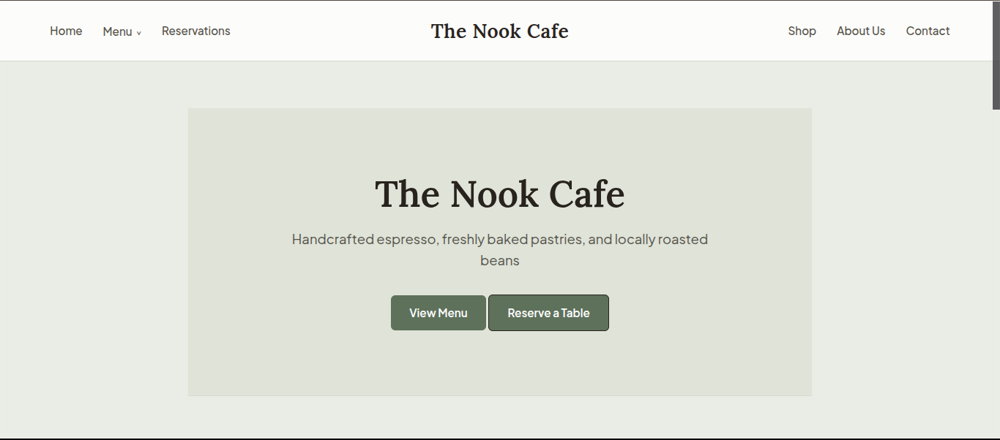
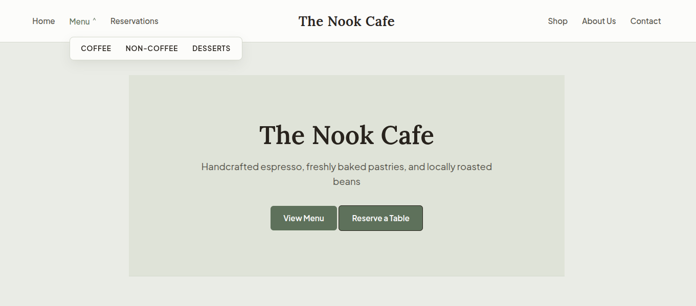

# The-Nook-Cafe

A modern, responsive website for [The Nook Cafe], designed to showcase our menu, reservations, shop, About Us, contact page.

## Table of Contents
- [Features](#features)
- [Built With](#built-with)
- [Screenshots](#screenshots)
- [Installation](#installation)
- [Project Structure](#project-structure)
- [Contributing](#contributing)
- [License](#License)
- [Contact](#contact)


## Features
- Interactive Drop-Down Menu: Navigation bar featuring a drop-down menu alongside links to *Home*, *Reservations*, *Shop*, *About Us*, and *Contact*.
- Cafe Favorites Showcase: responsive card grid showing signature drinks and pastries.
- Table Reservations: dedicated form allowing visitors to book a table at the cafe.
- Cafe Shop: Product showcase for cafe goods, complete with a visual shopping cart icon.
- About Us & Contact: showing the story behind The Nook Cafe, and contact details.
- Responsive Design: fully optimized for mobile, tablet, and desktop screens.

## Built With 
- HTML5
- CSS3
- JavaScript
- StackBlizt

## Screenshots
| Desktop View |  Desktop View showing drop-down menu | Mobile View |




## Installation 
- No built tools or package installations are required to run this project.

## Project Structure

```text
The-Nook-Cafe/
├── index.html          # Main landing page
├── menu.html           # Full cafe menu page
├── reservations.html   # Table booking page
├── online.html         # Cafe shop / online ordering mock-up
├── about.html          # About Us & cafe story page
├── contact.html        # Contact details, location, and hours
├── styles.css          # Custom styling and responsive layout
├── script.js           # Interactive menu drop-down logic
├── package.json        # Project metadata and dependencies
├── package-lock.json   # Dependency lockfile
├── .gitignore          # Files ignored by Git
└── README.md           # Project documentation
```

## Contributing
- Contributing, issues, and feature requests are welcome!

## License
-This project is open source and available for any purposes. Feel free to explore, fork, and adapt the code.

## Contact
- Lianready** - [@Lianready](https://github.com/Lianready)
**Project Link** - []()

## 🔗 Links
